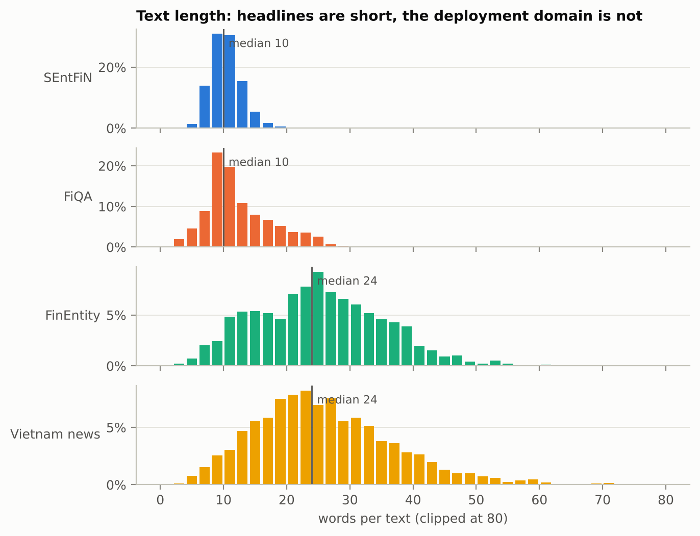
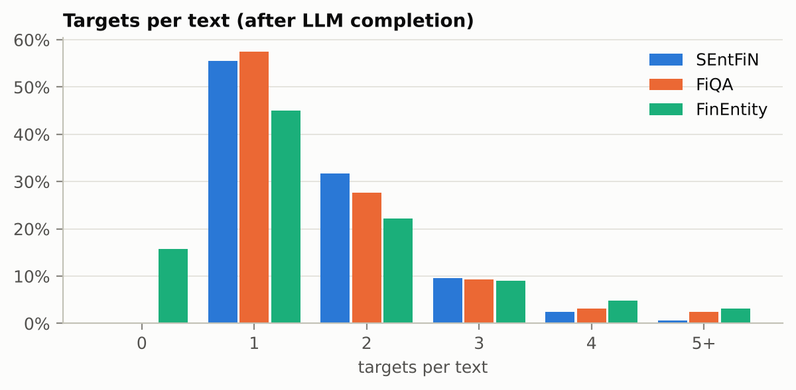
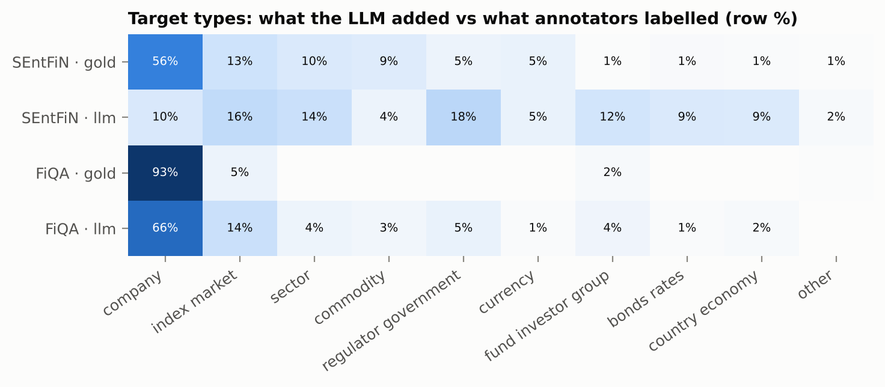
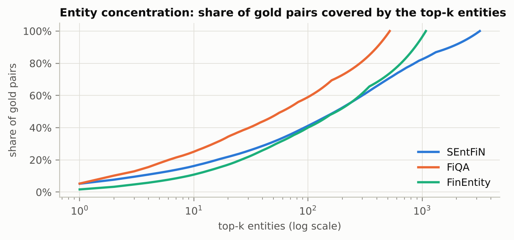
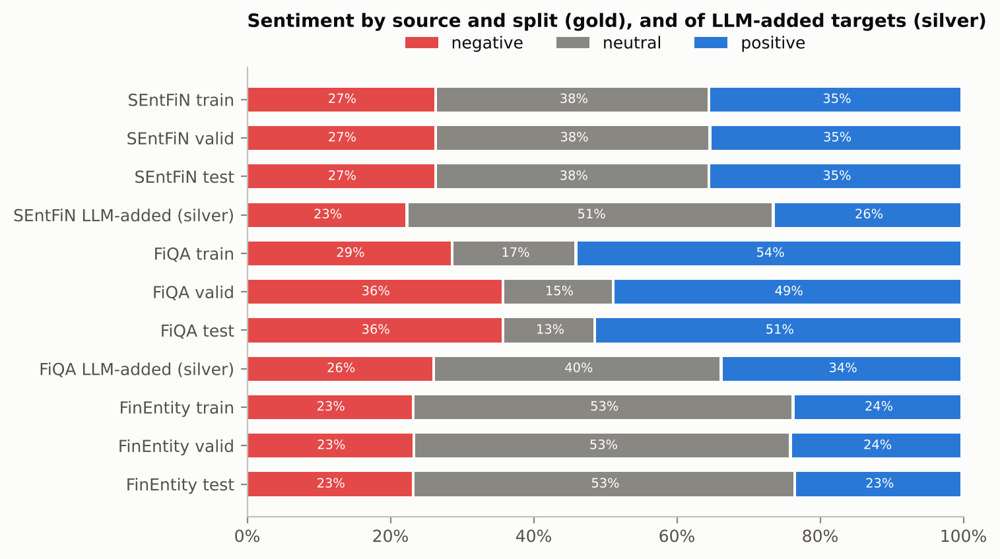
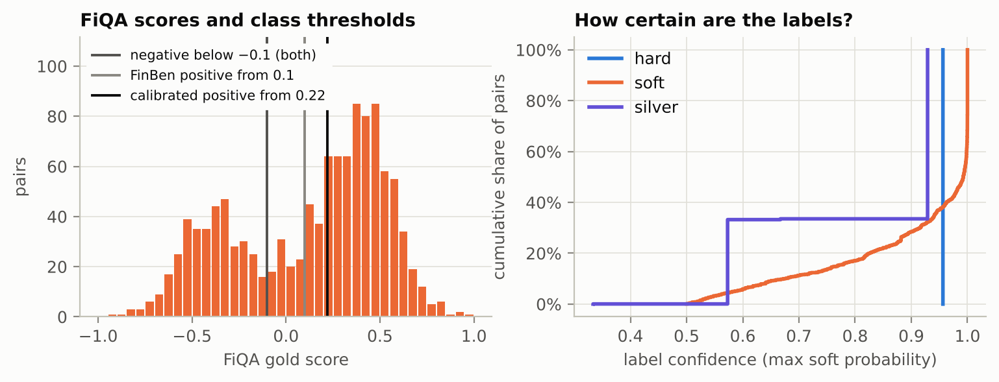
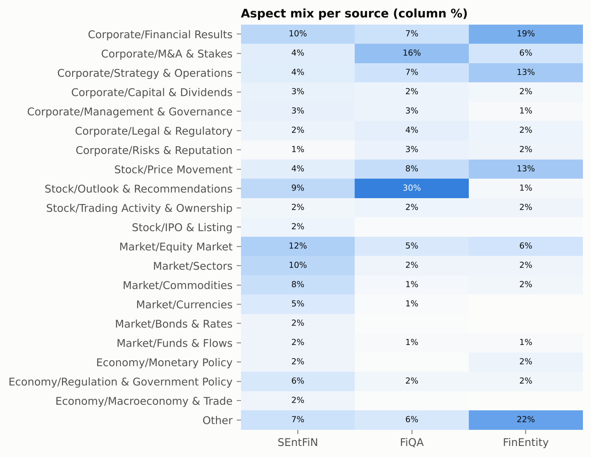
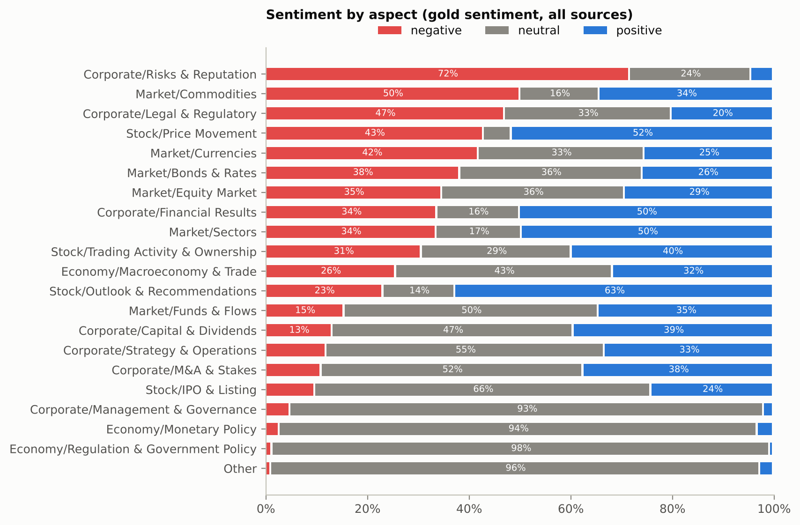
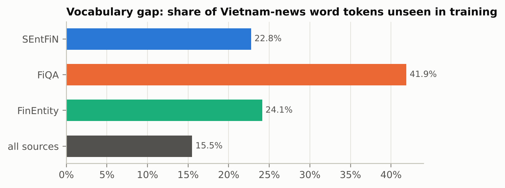

# Exploratory data analysis

_Generated by `python -m absa_data eda` from `data/processed` (21,189 pairs) and the crawler exports; figures in `figures/`._

## 1. Corpus at a glance

| source | split | texts | texts without target | pairs | gold targets | LLM-added |
|---|---|---|---|---|---|---|
| SEntFiN | train | 8,542 | 0 | 13,720 | 11,453 | 2,267 |
| SEntFiN | valid | 1,067 | 0 | 1,734 | 1,432 | 302 |
| SEntFiN | test | 1,070 | 0 | 1,729 | 1,433 | 296 |
| FiQA | train | 770 | 0 | 1,233 | 822 | 411 |
| FiQA | valid | 111 | 0 | 216 | 117 | 99 |
| FiQA | test | 230 | 0 | 426 | 234 | 192 |
| FinEntity | train | 1,098 | 171 | 1,704 | 1,704 | 0 |
| FinEntity | valid | 134 | 21 | 213 | 213 | 0 |
| FinEntity | test | 139 | 23 | 214 | 214 | 0 |

Text types: SEntFiN: headline 10,679, FiQA: headline 436, post 675, FinEntity: news 1,371.
 Target domain: 3,962 crawler sentences from 154 articles (vneconomy 3,023, vietnamnews 939).

All sources: **21,189 (text, target) pairs** in **13,161 texts**; 83.2% of targets are gold.

## 2. Text length

| source | texts | median words | p95 | p99 | max |
|---|---|---|---|---|---|
| SEntFiN | 10,679 | 10 | 14 | 17 | 23 |
| FiQA | 1,111 | 10 | 23 | 26 | 30 |
| FinEntity | 1,371 | 24 | 42 | 52 | 65 |
| Vietnam news (crawler) | 3,808 | 24 | 46 | 58 | 116 |

Crawler titles alone: median 10 words.

**Takeaways.** SEntFiN and FiQA are headline-length (median 10 and 10 words); FinEntity sentences (median 24) are the closest to the deployment sentences (median 24). With roughly 1.3 subword tokens per word, a max length of 128 tokens covers the p99 of every source (58 words for the crawler); 64 would truncate long news sentences.

## 3. Targets per text

| source | 0 | 1 | 2 | 3 | 4 | 5+ | mean targets/text | mixed-polarity texts (of texts with a target) |
|---|---|---|---|---|---|---|---|---|
| SEntFiN | 0.0% | 55.6% | 31.7% | 9.6% | 2.5% | 0.6% | 1.61 | 22.5% |
| FiQA | 0.0% | 57.5% | 27.6% | 9.3% | 3.2% | 2.4% | 1.69 | 22.2% |
| FinEntity | 15.7% | 45.1% | 22.2% | 9.0% | 4.8% | 3.1% | 1.55 | 9.0% |

Before completion (gold only), texts with more than one target: SEntFiN 26.6%, FiQA 5.1%, FinEntity 46.5%.

| source | target words, median | p95 | relative start position, median |
|---|---|---|---|
| SEntFiN | 1 | 3 | 0.16 |
| FiQA | 1 | 2 | 0.17 |
| FinEntity | 1 | 4 | 0.36 |

**Takeaways.** FiQA was the most under-annotated source: completion lifts its multi-target texts from 5.1% to 42.5% (SEntFiN: 26.6% to 44.4%), so the target-contrast cases ABSA is about now exist in every source. FinEntity's sentences with a target are the most often multi-target (46.5%), and its 215 target-free sentences are the negatives a span tagger needs. Targets are short (1-2 words); in headlines they tend to come first, in news sentences they sit mid-sentence.

## 4. Target types

| type | SEntFiN gold | SEntFiN llm | FiQA gold | FiQA llm |
|---|---|---|---|---|
| company | 8,004 | 290 | 1,089 | 464 |
| index_market | 1,862 | 470 | 53 | 98 |
| sector | 1,376 | 397 | 4 | 30 |
| commodity | 1,228 | 128 | 1 | 21 |
| regulator_government | 651 | 524 | 0 | 38 |
| currency | 754 | 146 | 0 | 7 |
| fund_investor_group | 75 | 334 | 21 | 26 |
| bonds_rates | 168 | 271 | 0 | 6 |
| country_economy | 125 | 261 | 0 | 11 |
| other | 75 | 44 | 5 | 1 |

**Takeaways.** Gold SEntFiN and FiQA targets are mostly companies; the LLM additions are dominated by what annotators skipped: regulators and governments, indices and markets, sectors, rates and countries. FinEntity has no `target_type` (it was not completed).

## 5. Entities and shortcut risk

| source | distinct entities | top-10 share | top-100 share | seen once | most frequent |
|---|---|---|---|---|---|
| SEntFiN | 3,198 | 16.2% | 41.2% | 58.9% | Nifty (743), Sebi (360), Gold (260), Rupee (194), Brent (159) |
| FiQA | 520 | 25.1% | 59.0% | 69.0% | AAPL (62), TSLA (58), SPY (31), FB (31), Tesco (29) |
| FinEntity | 1,078 | 10.8% | 40.1% | 68.1% | S&P 500 (35), Refinitiv (35), Tesla (31), Apple (23), Goldman Sachs (21) |

**Entity priors (gold only, test split).** If sentiment can be guessed from the entity name, a model can score well without reading the text.

| source | test pairs, entity seen in train | majority-class acc. | entity-prior acc. | entities (>= 5 train mentions) with one label >= 80% |
|---|---|---|---|---|
| SEntFiN | 86.5% | 38.2% | 53.4% | 23.2% |
| FiQA | 74.8% | 51.3% | 54.3% | 9.1% |
| FinEntity | 45.3% | 53.3% | 56.5% | 34.4% |

**Takeaways.** FiQA is the most concentrated (a handful of tickers such as AAPL and TSLA), but its entity prior barely beats the majority class. SEntFiN is where entity identity is a real shortcut: most test entities were seen in training and guessing each entity's training majority label adds about 15 points over the majority class (regulators and exchanges are almost always neutral). FinEntity has many label-consistent entities but fewer than half of its test entities appear in training. Report SEntFiN on `entity_seen_in_train == False` and consider masking the target string.

## 6. Sentiment labels

| group | pairs | negative | neutral | positive |
|---|---|---|---|---|
| SEntFiN train | 11,453 | 26.5% | 38.2% | 35.3% |
| SEntFiN valid | 1,432 | 26.5% | 38.3% | 35.2% |
| SEntFiN test | 1,433 | 26.5% | 38.2% | 35.3% |
| SEntFiN LLM-added (silver) | 2,865 | 22.5% | 51.1% | 26.4% |
| FiQA train | 822 | 28.8% | 17.3% | 53.9% |
| FiQA valid | 117 | 35.9% | 15.4% | 48.7% |
| FiQA test | 234 | 35.9% | 12.8% | 51.3% |
| FiQA LLM-added (silver) | 702 | 26.2% | 40.2% | 33.6% |
| FinEntity train | 1,704 | 23.4% | 53.1% | 23.6% |
| FinEntity valid | 213 | 23.5% | 52.6% | 23.9% |
| FinEntity test | 214 | 23.4% | 53.3% | 23.4% |

**Takeaways.** Splits are well stratified within each source. The three sources differ in their neutral share: FinEntity is the most neutral, FiQA the most positive even after calibration. LLM-added targets are more often neutral than gold ones (regulators, indices and sources are mentioned rather than judged). Use class weights or the soft labels; macro-F1 is the headline metric.

## 7. Score thresholds and soft labels

| label type | pairs | median confidence | below 0.8 | below 0.6 |
|---|---|---|---|---|
| hard | 16,449 | 0.956 | 0.0% | 0.0% |
| soft | 1,173 | 0.993 | 17.1% | 6.0% |
| silver | 3,567 | 0.929 | 33.5% | 33.2% |

17.1% of FiQA gold pairs lie within 0.1 of a FinBen threshold; with annotation noise of about σ = 0.08 their class is uncertain, which is what the soft labels encode. Hard labels (SEntFiN, FinEntity) stay near 0.96; silver labels split by the bridge annotator's confidence (high ≈ 0.93, medium ≈ 0.57).

## 8. Aspect categories (silver)

| aspect | SEntFiN | FiQA | FinEntity | train pairs (all) | negative / neutral / positive |
|---|---|---|---|---|---|
| Corporate/Financial Results | 1,696 | 137 | 415 | 1,774 | 34% / 16% / 50% |
| Corporate/M&A & Stakes | 674 | 293 | 136 | 868 | 11% / 52% / 38% |
| Corporate/Strategy & Operations | 724 | 130 | 279 | 885 | 12% / 55% / 33% |
| Corporate/Capital & Dividends | 503 | 44 | 32 | 459 | 13% / 47% / 39% |
| Corporate/Management & Governance | 509 | 47 | 16 | 470 | 5% / 93% / 2% |
| Corporate/Legal & Regulatory | 415 | 67 | 46 | 396 | 47% / 33% / 20% |
| Corporate/Risks & Reputation | 103 | 50 | 42 | 128 | 72% / 24% / 4% |
| Stock/Price Movement | 653 | 155 | 284 | 844 | 43% / 5% / 52% |
| Stock/Outlook & Recommendations | 1,632 | 565 | 24 | 1,669 | 23% / 14% / 63% |
| Stock/Trading Activity & Ownership | 271 | 42 | 44 | 289 | 31% / 29% / 40% |
| Stock/IPO & Listing | 386 | 8 | 9 | 325 | 10% / 66% / 24% |
| Market/Equity Market | 2,030 | 101 | 138 | 1,838 | 35% / 36% / 29% |
| Market/Sectors | 1,695 | 37 | 43 | 1,425 | 34% / 17% / 50% |
| Market/Commodities | 1,366 | 25 | 35 | 1,135 | 50% / 16% / 34% |
| Market/Currencies | 902 | 10 | 2 | 729 | 42% / 33% / 25% |
| Market/Bonds & Rates | 344 | 7 | 3 | 280 | 38% / 36% / 26% |
| Market/Funds & Flows | 366 | 11 | 14 | 308 | 15% / 50% / 35% |
| Economy/Monetary Policy | 339 | 5 | 53 | 305 | 3% / 94% / 3% |
| Economy/Regulation & Government Policy | 973 | 30 | 37 | 822 | 1% / 98% / 1% |
| Economy/Macroeconomy & Trade | 342 | 7 | 3 | 283 | 26% / 43% / 32% |
| Other | 1,260 | 104 | 476 | 1,425 | 1% / 96% / 3% |

LLM aspect confidence: high 81.3%, medium 18.3%, low 0.4%.

**Takeaways.** The sources are complementary: FiQA is dominated by stock outlook and recommendations (StockTwits calls), FinEntity by financial results, price moves and 'Other' (quoted sources such as Refinitiv), and SEntFiN covers the Market/Economy categories the others barely touch. Categories with fewer than 150 training pairs (Corporate/Risks & Reputation) will be hard to learn; merge them at level 1 or report macro-F1 per level. Aspect strongly conditions sentiment (Corporate/Risks is mostly negative; Management, Monetary Policy, Regulation and Other are over 90 % neutral). A joint model can exploit this, but it is also a shortcut: check sentiment on those aspects separately.

## 9. Deployment domain: English news about Vietnam

| training vocabulary | word types | OOV on its own test | OOV on Vietnam news |
|---|---|---|---|
| SEntFiN | 8,526 | 4.3% | 22.8% |
| FiQA | 3,157 | 21.7% | 41.9% |
| FinEntity | 5,180 | 11.7% | 24.1% |
| all three sources | 12,318 | - | 15.5% |

**Vietnam-specific entities.** How often the training data mentions what the deployed model will see most:

| term | training texts mentioning it | Vietnam-news sentences mentioning it |
|---|---|---|
| vietnam | 1 | 655 |
| ho chi minh | 1 | 68 |
| hanoi | 0 | 55 |
| hcm city | 0 | 29 |
| sbv | 0 | 20 |
| vn-index | 0 | 15 |
| state bank of vietnam | 0 | 13 |
| petrovietnam | 0 | 11 |
| dong | 0 | 9 |
| hoa phat | 0 | 8 |
| vnd | 0 | 8 |
| hose | 0 | 7 |

11.5% of crawler sentences contain at least one of the 3,000 longest entity names seen as training targets.

**Takeaways.** Even the union of the three training sources leaves a noticeable share of Vietnam-news word tokens unseen, and Vietnam-specific entities (VN-Index, the State Bank of Vietnam, Vietnamese companies, the dong) are almost absent from training. Expect a drop on the planned Vietnam test set, especially for target extraction; the small annotated Vietnam test set is the only honest estimate, and a few hundred in-domain training sentences (silver-labelled like SEntFiN) would likely help more than any architecture change.

## 10. Data quality and leakage checks

| check | result |
|---|---|
| texts appearing in two sources (near-duplicates) | 0 |
| near-duplicate texts across splits within a source | FinEntity 0, FiQA 3, SEntFiN 0 |
| pairs whose target was not found in the text | 6 |
| pairs with any quality flag | 5,081 |

**Most common quality flags**

| flag | pairs |
|---|---|
| llm_target | 3,567 |
| reuters_codes_removed | 1,256 |
| replacement_char_in_text | 112 |
| entity_repaired | 97 |
| duplicate_merged | 80 |
| section_prefix_removed | 24 |
| mojibake_repaired | 17 |
| aspect_normalized | 17 |
| target_corrected | 14 |
| target_not_in_text | 6 |

The only cross-split near-duplicates are FiQA's (3 re-posted tweets in the official splits, flagged `near_duplicate_across_splits`); SEntFiN and FinEntity splits are grouped so none exist.

## 11. Implications for modelling

1. **Sequence length:** 128 subword tokens; nothing needs more than ~100 words.
2. **Class balance (combined train):** weights negative 1.29, neutral 0.82, positive 0.99; or train on the soft labels.
3. **Target extraction:** train the span head on FinEntity (exhaustive, with negative sentences) plus the LLM-completed SEntFiN/FiQA texts; evaluate it on FinEntity test and the Vietnam test set only.
4. **Shortcut control:** report SEntFiN on unseen entities; consider masking the target string for a share of training examples.
5. **Aspects:** 21 categories with a long tail; report level-1 and level-2 macro-F1, and treat test aspect scores as agreement with the LLM (no human aspect labels except FiQA's `fiqa_aspect`).
6. **Source tag:** label conventions differ (neutral share 16-53 %); add the source as an input token or evaluate per source.
7. **Deployment domain:** the vocabulary and entity gap to Vietnam news is the largest risk; build the annotated Vietnam test set early and consider silver in-domain training data.
